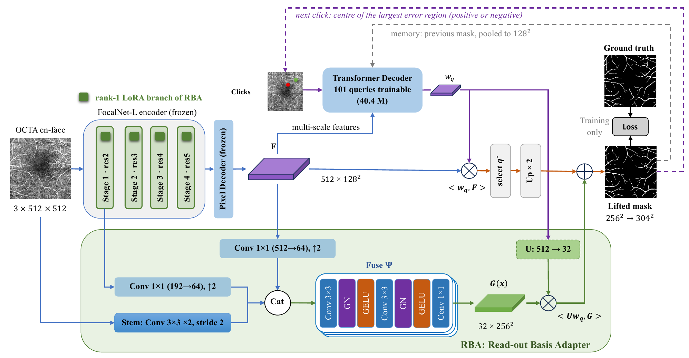
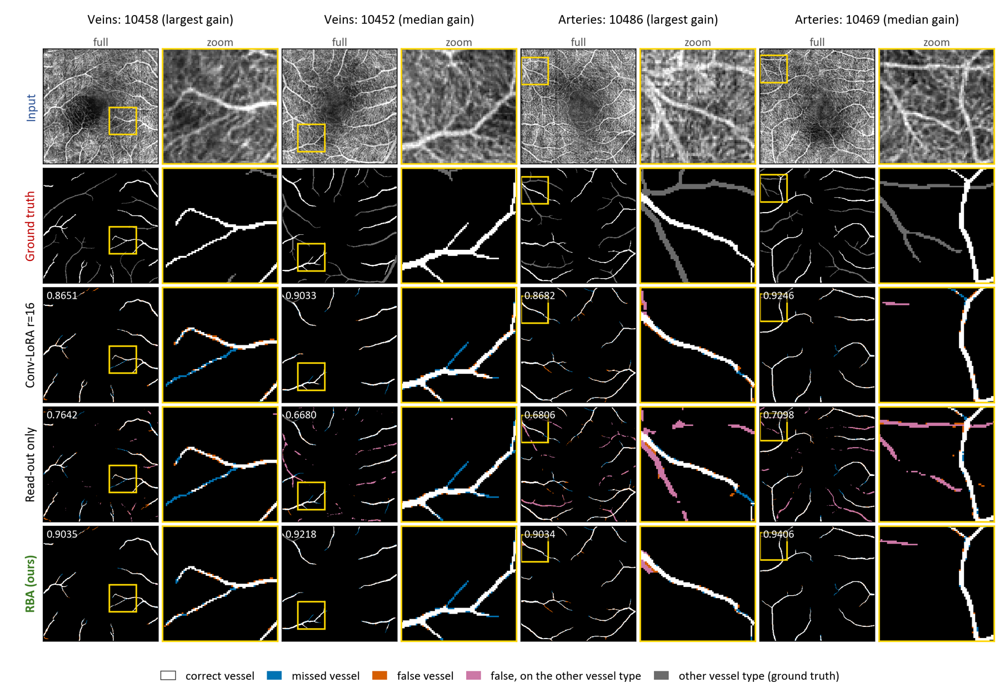

# RBA: A Read-out Basis Adapter for Parameter-Efficient Interactive OCTA Vessel Segmentation with SEEM

Official code for the article *RBA: A Read-out Basis Adapter for Parameter-Efficient Interactive OCTA Vessel Segmentation with SEEM* (J. M. Al-Ghabban and M. R. Mohammadi, Iran University of Science and Technology).

SEEM reads every candidate mask as the dot product of a query vector `w_q` with one feature map `F` at a quarter of the input resolution. Encoder adapters such as LoRA, Conv-LoRA and AdaptFormer change the content of `F`, but not its resolution or the way it is read.

**RBA adapts the read-out itself.** It adds 32 zero-initialised, image-only basis maps `G(x)` at half the input resolution, which every candidate reads through its own vector:

```
m_q = Up(<w_q, F>) + <U w_q, G(x)>        U = 0 at the start, so training starts exactly from SEEM
```

A rank-1 LoRA branch adapts the encoder. In total, RBA has 474,168 parameters, 0.14% of SEEM.



## Results (OCTA-500 3 mm, large vessels, 50 test images)

All results use a deployable protocol: the model selects its own candidate, the threshold is fixed at 0.5, and predictions are scored on the native label grid after four error-driven clicks. All results come from one training seed.

| Method | Adapter params | Dice@4 | clDice | NoC@90 |
|---|---|---|---|---|
| No adapter | 0 | 0.7583 | 0.8044 | 20.00 |
| LoRA r=1 | 0.27 M | 0.8947 | 0.9234 | 11.80 |
| LoRA r=16 | 4.33 M | 0.9013 | 0.9279 | 7.46 |
| Conv-LoRA r=16 | 4.35 M | 0.9023 | 0.9290 | 6.44 |
| AdaptFormer | 0.45 M | 0.8952 | 0.9253 | 11.18 |
| RBA read-out branch only | 0.20 M | 0.9056 | 0.9215 | 5.64 |
| Conv-LoRA r=16 + RBA read-out | 4.55 M | 0.9182 | 0.9389 | 3.02 |
| LoRA r=16 + RBA read-out | 4.54 M | 0.9178 | 0.9390 | 3.00 |
| **RBA (ours)** | **0.47 M** | **0.9195** | 0.9385 | 3.38 |

RBA against Conv-LoRA r=16 on the other targets and datasets (Dice@4, paired over the test images, Holm-corrected Wilcoxon test):

| Dataset | Target | RBA | Conv-LoRA | Δ [95% CI] | RBA better | p |
|---|---|---|---|---|---|---|
| OCTA-500 3 mm | Veins | 0.9049 | 0.8887 | +0.0162 [+0.0131, +0.0192] | 45/50 | <1e-10 |
| OCTA-500 3 mm | Arteries | 0.9126 | 0.8969 | +0.0157 [+0.0130, +0.0184] | 48/50 | <1e-10 |
| OCTA-500 3 mm | FAZ | 0.9752 | 0.9786 | −0.0034 [−0.0090, +0.0021] | 25/50 | 0.59 |
| OCTA-500 6 mm | Large vessels | 0.8867 | 0.8591 | +0.0276 [+0.0259, +0.0292] | 50/50 | <1e-10 |
| ROSE-O | Vessels | 0.7755 | 0.7623 | +0.0132 [+0.0066, +0.0199] | 8/9 | 0.008 |
| ROSE-O | FAZ | 0.9524 | 0.9590 | −0.0066 [−0.0177, +0.0045] | 4/9 | 0.36 |

`results/five_metrics.csv` gives Dice, IoU, accuracy, sensitivity and specificity of both models on every target. These are the values in Supplementary Tables S1–S5.



## Repository contents

| File | What it does |
|---|---|
| `train_rba.py` | Trains or re-tests one configuration ("row") on one target and dataset; also runs the analyses of Tables 7 and 8 |
| `prepare_data.py` | Puts OCTA-500 (3 mm, 6 mm) and ROSE-O in the layout the trainer reads, and writes the official splits |
| `evaluate_five_metrics.py` | Dice, IoU, ACC, SE and SP of saved checkpoints (Supplementary Tables S1–S5) |
| `adapter_table.py` | The paired comparisons, factorial ablation and claims of Tables 1, 5 and 6, from the saved results |
| `rba_module.py` | RBA alone (read-out branch `HQBasis` and encoder branch `LoRALinear`), with numerical checks of its properties; runs on a CPU |
| `setup_seem.py` | Downloads SEEM v1.0, adds the two patched SEEM files, and downloads SEEM's weights |
| `seem_patches/` | The two SEEM files changed for this work (see its README) |
| `notebooks/` | `run_experiments.ipynb` (every experiment, one cell each) and `rba_module_explained.ipynb` |
| `results/` | Measured results of the paper |

## 1. Installation

The code was run with Python 3.10, PyTorch 2.1.0 (CUDA 12.1) and Detectron2 0.6, on one NVIDIA RTX 3070 Laptop GPU (8 GB) under Windows.

```bash
git clone https://github.com/jaafaralghabban/seem-octa.git
cd seem-octa
conda env create -f environment.yml
conda activate rba-seem
pip install "git+https://github.com/MaureenZOU/detectron2-xyz.git"     # Detectron2 as used by SEEM
python setup_seem.py                                                  # SEEM v1.0 + patches + weights
```

Check the RBA module on its own. This needs only PyTorch, runs on a CPU and takes about a minute:

```bash
python rba_module.py
```

## 2. Data

The datasets are not redistributed here.

- **OCTA-500:** download from [IEEE DataPort](https://ieee-dataport.org/open-access/octa-500).
- **ROSE-O:** request it from its authors (Hao et al., IEEE TMI 2022).

Place the data as follows, or set the folders in the `Config` class of `prepare_data.py`:

```
octa/OCTA_3mm/OCTA(FULL) | OCTA(ILM_OPL) | OCTA(OPL_BM)/<id>.bmp
octa/OCTA_6mm/OCTA(FULL) | OCTA(ILM_OPL) | OCTA(OPL_BM)/<id>.bmp
octa/Label/Label/GT_LargeVessel | GT_Artery | GT_Vein | GT_FAZ | GT_Capillary/<id>.bmp
ROSE-O/{train,test}/img/{SVC,DVC,IVC}  and  ROSE-O/{train,test}/gt/{vessel,FAZ}
```

Then run:

```bash
python prepare_data.py
```

It prints READY for each dataset and writes the splits to `checkpoints/`:

| Dataset | Train | Validation | Test |
|---|---|---|---|
| OCTA-500 3 mm | 10301–10440 | 10441–10450 | 10451–10500 |
| OCTA-500 6 mm | 10001–10240 | 10241–10250 | 10251–10300 |
| ROSE-O | 25 subjects | 5 subjects (seed 42) | 9 subjects |

## 3. Training and testing

```bash
python train_rba.py --row H1_lora1_hq --task GT_LargeVessel --subset OCTA_3mm            # RBA (ours)
python train_rba.py --row C_convlora  --task GT_LargeVessel --subset OCTA_3mm            # Conv-LoRA r=16
python train_rba.py --row H1_lora1_hq --task GT_LargeVessel --subset OCTA_3mm --run eval # re-test only
```

Each run trains for 100 epochs and saves its results to `checkpoints/`:
- `best_<row>_<task>_<subset>.pth`, the checkpoint with the best validation Dice@4;
- `results_<row>_<task>_<subset>.npz`, the per-image test results;
- `last_<row>_<task>_<subset>.pth`, the state after the last finished epoch. Running the same command again continues from it.

On one RTX 3070 Laptop GPU, one epoch of RBA takes about 4.8 min on the 3 mm subset.

| `--row` | Configuration in the paper |
|---|---|
| `H1_lora1_hq` | **RBA**: rank-1 LoRA + RBA read-out |
| `H_hq_only_ep100` | RBA read-out branch only |
| `B1_lora1_ep100`, `B_lora`, `C_convlora`, `AF_adaptformer` | LoRA r=1, LoRA r=16, Conv-LoRA r=16, AdaptFormer |
| `D_convlora_hq`, `B_lora_hq` | Conv-LoRA r=16 / LoRA r=16 + RBA read-out |
| `A_decoder_only` | no adapter (only SEEM's decoder trains) |
| `H1_frozendec`, `C_convlora_frozendec`, `B1_lora1_frozendec`, `H1_adapteronly` | all of SEEM frozen (Table 2) |
| `R_rida`, `R_no_ridge`, `R_no_readout`, `R_no_encoder` | RiDA, the alternative read-out design, and its ablation |

`--task` takes one of `GT_LargeVessel`, `GT_Vein`, `GT_Artery`, `GT_FAZ`, `GT_Capillary`, `GT_RoseVessel` or `GT_RoseFAZ`. `--subset` takes one of `OCTA_3mm`, `OCTA_6mm` or `ROSE_O`.

## 4. Reproducing the tables

```bash
python adapter_table.py                                   # Tables 1, 5, 6: paired tests and claims
python evaluate_five_metrics.py                           # Supplementary Tables S1-S5
python train_rba.py --run calibre_check --task GT_LargeVessel --subset OCTA_3mm   # Table 8
python train_rba.py --run vein_check    --task GT_Vein        --subset OCTA_3mm   # Table 7
```

`notebooks/run_experiments.ipynb` lists every training run of the paper in the order we ran them.

## 5. Trained weights

The trained checkpoints are attached to the [Releases](https://github.com/jaafaralghabban/seem-octa/releases) of this repository. Put them in `checkpoints/` and re-test them with `--run eval`.

## Citation

```bibtex
@article{alghabban2026rba,
  title   = {{RBA}: A Read-out Basis Adapter for Parameter-Efficient Interactive {OCTA} Vessel Segmentation with {SEEM}},
  author  = {Al-Ghabban, Jaafar M. and Mohammadi, Mohammad Reza},
  journal = {Preprint submitted to Elsevier},
  year    = {2026}
}
```

## License and acknowledgements

The code in this repository is released under the MIT License (see `LICENSE`). The files in `seem_patches/` are modified versions of SEEM files and keep SEEM's Apache License 2.0.

We thank the authors of [SEEM](https://github.com/UX-Decoder/Segment-Everything-Everywhere-All-At-Once), [OCTA-500](https://ieee-dataport.org/open-access/octa-500) and ROSE-O.
